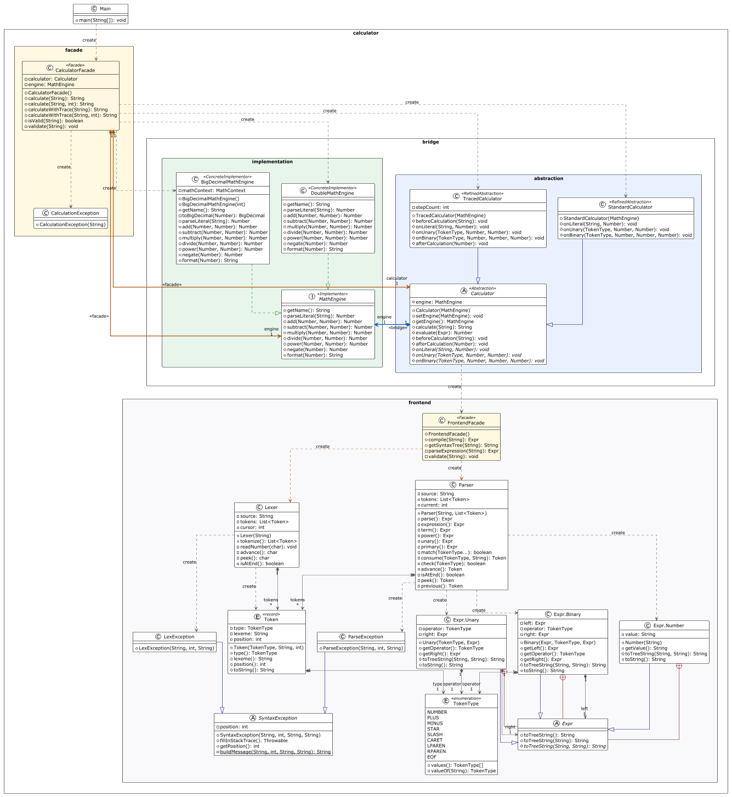

# AST Calculator — Facade Design Pattern


-blue.svg)


An arithmetic expression compiler and computation engine featuring a multi-stage compiler pipeline (**Lexical Scanner $\rightarrow$ Recursive Descent Parser $\rightarrow$ Abstract Syntax Tree**) and dual arithmetic backends (**IEEE-754 64-bit float vs. Arbitrary-Precision BigDecimal**), encapsulated behind the **Gang of Four (GoF) Facade Pattern**.

---

## 1. Problem Statement & Motivation

Directly evaluating mathematical expressions without a facade requires client applications to coordinate a complex, multi-stage subsystem:
1. Initialize the `Lexer` with character streams and track cursors.
2. Tokenize and pass the `Token` list into a recursive descent `Parser`.
3. Handle AST grammar validation and node hierarchies (`Expr`).
4. Select, configure, and bind a numeric execution backend (`DoubleMathEngine` vs. `BigDecimalMathEngine` with `MathContext`).
5. Assemble and configure the appropriate calculator abstraction (`Calculator` vs. `TracedCalculator`) via `CalculatorBuilder`.
6. Catch and resolve low-level compiler and runtime diagnostics (`LexException`, `ParseException`, `MathException`).

This tight coupling forces clients to understand internal compilation mechanics, builder configurations, and arithmetic engine wiring. The **Facade Pattern** solves this by providing unified, high-level interfaces that shield clients from subsystem complexity while keeping the subsystem classes modular, independently usable, and unaware of the facade.

---

## 2. Technical Requirements Mapping

| Assignment Requirement             | Implementation in Project                                                  | Details                                                                                                                                                                                             |
|:-----------------------------------|:---------------------------------------------------------------------------|:----------------------------------------------------------------------------------------------------------------------------------------------------------------------------------------------------|
| **Complex Subsystem (4+ Classes)** | `Lexer`, `Parser`, `Expr`, `Calculator`, `MathEngine`, `CalculatorBuilder` | Real, non-trivial interactions: token stream generation, recursive descent CFG parsing, tree evaluation, and multi-precision arithmetic.                                                            |
| **Main Facade**                    | `class CalculatorFacade`                                                   | Exposes a streamlined API (`calculateDouble`, `calculatePrecise`, `calculateTraced`, `calculateTracedPrecise`, `canCalculate`) coordinating engine binding, AST compilation, and calculation modes. |
| **Additional Facade (Optional)**   | `class FrontendFacade`                                                     | A dedicated secondary facade in `calculator.frontend` exposing AST compilation and syntax tree inspection without evaluating.                                                                       |
| **Client**                         | `class Main` / External Consumers                                          | Interacts exclusively via the Facade API—never instantiates internal subsystem classes directly.                                                                                                    |
| **Zero Back-References**           | All subsystem classes                                                      | Subsystem classes (`Lexer`, `Parser`, `DoubleMathEngine`, etc.) have **zero imports or dependencies** on `CalculatorFacade` or `FrontendFacade`.                                                    |
| **Subsystem Bypassability**        | Advanced client support                                                    | Power users and compiler tools can bypass both facades to inspect tokens, construct custom ASTs, or implement custom math engines directly.                                                         |

---

## 3. Architecture & Structural Diagram



### Detailed Component Roles

- **Primary Facade (`CalculatorFacade`):** Orchestrates the full lifecycle of a mathematical evaluation. It coordinates `CalculatorBuilder` to pre-configure standard and traced `Calculator` instances across `DoubleMathEngine` and `BigDecimalMathEngine`, manages runtime `BigDecimal` precision, validates input, and translates subsystem exceptions into unified `CalculationException` instances.
- **Secondary Facade (`FrontendFacade`):** Segregates static language processing from execution. It coordinates `Lexer` and `Parser` to produce an `Expr` AST or an ASCII syntax tree without executing arithmetic.
- **Complex Subsystem Classes:**
   * `Lexer`: Scans input strings into typed tokens with exact character index tracking.
   * `Parser`: Enforces precedence and associativity using recursive descent.
   * `Expr` (`Number`, `Unary`, `Binary`): Sealed composite AST node hierarchy.
   * `Calculator` (`Calculator`, `TracedCalculator`): Traverses the AST using Template Method hooks for silent or step-by-step traced evaluation.
   * `MathEngine` (`DoubleMathEngine`, `BigDecimalMathEngine`): Implements IEEE-754 or arbitrary-precision `MathContext` arithmetic.
   * `CalculatorBuilder`: Fluent builder that assembles `Calculator` abstractions and binds them to `MathEngine` implementations.

---

## 4. Five Clean Code Principles (Justifications)

### 1. Meaningful Names (Self-Explanatory Facade API)
The public methods of `CalculatorFacade` reflect **client intent** rather than technical subsystem steps:
- Subsystem operations are granular and imperative: `lexer.tokenize()`, `parser.parse()`, `engine.parseLiteral()`, `builder.reset().precise().build()`.
- The Facade abstracts these into intuitive, declarative methods:
   * `calculateDouble(expression)` — evaluates using standard 64-bit IEEE-754 hardware precision.
   * `calculatePrecise(expression)` / `calculatePrecise(expression, precision)` — evaluates using arbitrary-precision decimal arithmetic (default 34 digits or custom precision).
   * `calculateTraced(expression)` / `calculateTracedPrecise(...)` — executes step-by-step diagnostic reduction.
   * `canCalculate(expression)` — verifies whether an expression is syntactically and mathematically valid without throwing exceptions.

### 2. Single Responsibility Principle (SRP)
The Facade **coordinates; it does not compute**.
- `CalculatorFacade` contains zero lexing rules, zero grammar verification code, and zero arithmetic logic.
- All parsing logic remains strictly within `Parser`, all tokenization remains within `Lexer`, all assembly logic remains within `CalculatorBuilder`, and all mathematical operations remain within `MathEngine`. The Facade solely acts as a traffic controller ensuring subsystem components interact in the proper sequence.

### 3. No Leaking of Subsystem Details (Information Hiding)
The Facade forms a strict abstraction barrier:
- `CalculatorFacade` accepts only standard types (`String`, `int`) and returns formatted `String` or `boolean` results.
- Internal subsystem abstractions (`Token`, `TokenType`, `Expr`, `MathEngine`, `Calculator`, `MathContext`) are completely shielded from the client.
- Low-level subsystem exceptions (`SyntaxException`, `LexException`, `ParseException`, `MathException`) are intercepted and converted into a unified domain exception (`CalculationException`), preventing parser and engine state leakage.

### 4. Small, Focused Subsystem Classes (High Cohesion)
Because `CalculatorFacade` and `FrontendFacade` take on the burden of wiring and lifecycle coordination, subsystem classes remain small, focused, and cohesive:
- `Lexer` (95 lines) only scans characters into tokens.
- `Parser` (135 lines) only enforces grammar rules.
- `BigDecimalMathEngine` only performs arithmetic under a given `MathContext`.
  None of these classes need boilerplate convenience methods or coordination logic to accommodate external clients.

### 5. Proper Error Handling for Coordination Failures
A core responsibility of a robust Facade is shielding clients from multi-layer failure cascades:
- If input is malformed, `Lexer` or `Parser` throws a `SyntaxException` with character-level cursor information.
- If a division by zero or undefined exponentiation occurs, `MathEngine` throws a `MathException`.
- `CalculatorFacade` captures these distinct subsystem failures in `validateAndCalculate`, protects client execution flow, and rethrows a descriptive `CalculationException` containing the underlying cause:
  ```java
  try {
      return calculator.calculate(expression);
  } catch (SyntaxException | MathException e) {
      throw new CalculationException("Calculation failed: " + e.getMessage());
  }
```

---

## 5. Formal Grammar & Compiler Subsystem

The underlying frontend subsystem implements a **Deterministic Recursive Descent Parser** adhering to the following Context-Free Grammar (CFG) in Extended Backus-Naur Form (EBNF):

```ebnf
expression ::= term ( ( "+" | "-" ) term )*
term       ::= unary ( ( "*" | "/" ) unary )*
unary      ::= "-" unary | power                 (* Right-associative prefix negation *)
power      ::= primary ( "^" unary )?            (* Right-associative exponentiation *)
primary    ::= NUMBER | "(" expression ")"
NUMBER     ::= [0-9]+ ( "." [0-9]+ )?
```

### Precedence & Associativity Table

| Precedence      | Operators       | Description                        | Associativity | Subsystem Method      |
|-----------------|-----------------|------------------------------------|---------------|-----------------------|
| **1 (Highest)** | Literals, `( )` | Numbers and sub-expressions        | N/A           | `Parser.primary()`    |
| **2**           | `^`             | Exponentiation (`2 ^ 3 ^ 2 = 512`) | Right-to-Left | `Parser.power()`      |
| **3**           | `-`             | Prefix negation (`-2 ^ 2 = -4`)    | Right-to-Left | `Parser.unary()`      |
| **4**           | `*`, `/`        | Multiplication, Division           | Left-to-Right | `Parser.term()`       |
| **5 (Lowest)**  | `+`, `-`        | Addition, Subtraction              | Left-to-Right | `Parser.expression()` |

### Compiler Diagnostic Errors
When an invalid expression bypasses client-side validation, the subsystem produces compiler-grade visual diagnostics:
```text
  3 + * 4
      ^
Parse Error: Expected number or '(' but found: '*'
```

---

## 6. Project Directory Structure

```text
src/
└── calculator/
    ├── Main.java                      # Client application
    ├── CalculatorFacade.java          # PRIMARY FACADE (Evaluations & Subsystem Gateway)
    ├── CalculatorBuilder.java         # Fluent builder for Calculator & MathEngine assembly
    ├── CalculationException.java      # Unified exception shielding subsystem errors
    │
    ├── frontend/                      # Subsystem: Compiler Front-End
    │   ├── FrontendFacade.java        # SECONDARY FACADE (AST Compilation & Tree Dump)
    │   ├── TokenType.java             # Token classification enum
    │   ├── Token.java                 # Immutable token record
    │   ├── Lexer.java                 # Lexical character scanner
    │   ├── Parser.java                # Recursive descent parser
    │   ├── Expr.java                  # Sealed AST hierarchy (Number, Binary, Unary)
    │   ├── SyntaxException.java       # Visual diagnostic base exception
    │   ├── LexException.java          # Scanner syntax error
    │   ├── ParseException.java        # Grammar syntax error
    │   └── MathException.java         # Arithmetic evaluation error
    │
    └── bridge/                        # Subsystem: Arithmetic & Evaluation Engines
        ├── abstraction/
        │   ├── Calculator.java        # Silent AST evaluator base (coordinates via FrontendFacade)
        │   └── TracedCalculator.java  # Step-by-step diagnostic evaluator
        │
        └── implementation/
            ├── MathEngine.java            # Numeric computation SPI
            ├── DoubleMathEngine.java      # IEEE-754 hardware floating-point engine
            └── BigDecimalMathEngine.java  # Arbitrary-precision decimal engine
```

---

## 7. Build and Run

### Prerequisites
* Java JDK 21 or higher.

### Compilation
From the project root:
```bash
javac -d out --source-path src src/calculator/*.java
```

### Execution
```bash
java -cp out calculator.Main
```

---

## 8. Sample Execution Output

```text
==================================================
  SOFTWARE DESIGN PATTERNS - FACADE PATTERN DEMO    
==================================================

1. Double Evaluation:
   Expr:   10 / 3 + 2 * 4
   Result: 11.333333333333334

2. High Precision (50 digits):
   Expr:   0.1 + 0.2
   Result: 0.3

3. Traced Evaluation:
==================================================
Tracing Expression: 3 + 4 * (2 - 1) ^ 3
Active Backend:     IEEE-754 64-bit Double Engine
--------------------------------------------------
  Step 01: [LITERAL] Read '3' -> 3.0
  Step 02: [LITERAL] Read '4' -> 4.0
  Step 03: [LITERAL] Read '2' -> 2.0
  Step 04: [LITERAL] Read '1' -> 1.0
  Step 05: [BINARY]  2.0 MINUS 1.0 = 1.0
  Step 06: [LITERAL] Read '3' -> 3.0
  Step 07: [BINARY]  1.0 CARET 3.0 = 1.0
  Step 08: [BINARY]  4.0 STAR 1.0 = 4.0
  Step 09: [BINARY]  3.0 PLUS 4.0 = 7.0
--------------------------------------------------
Final Result: 7.0
==================================================

4. Validity checking:
   Expression '10 / 3 + 2 * 4'      is valid: true
   Expression '9 + 3 * (2 + 2) / 0' is valid: false

5. Error Handling via Facade:
   Caught expected error: Calculation failed: 

  10 + * 2
       ^
Parse Error: Expected number or '(' but found: '*'
```